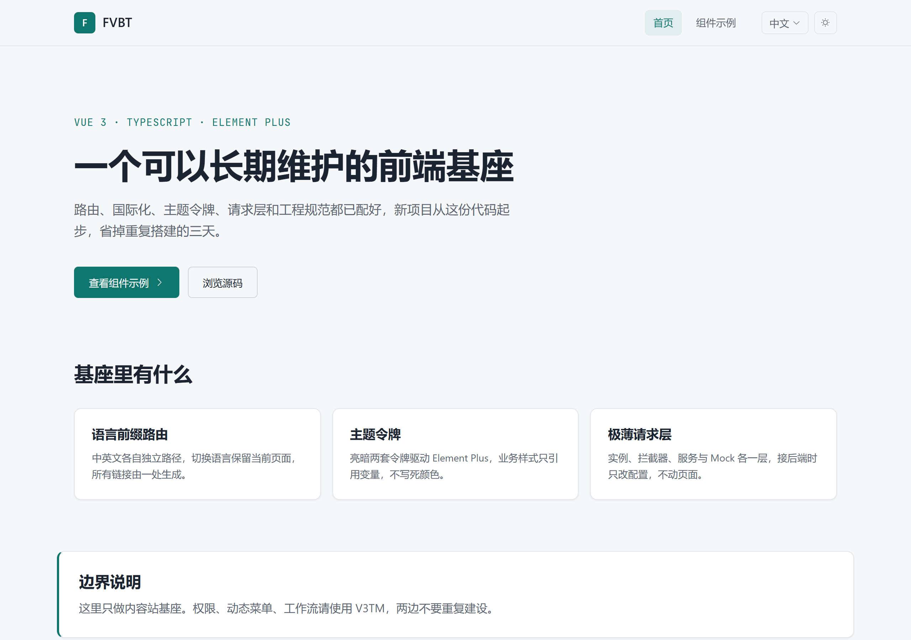
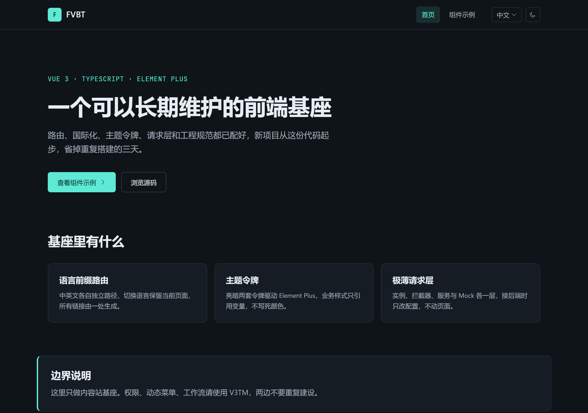
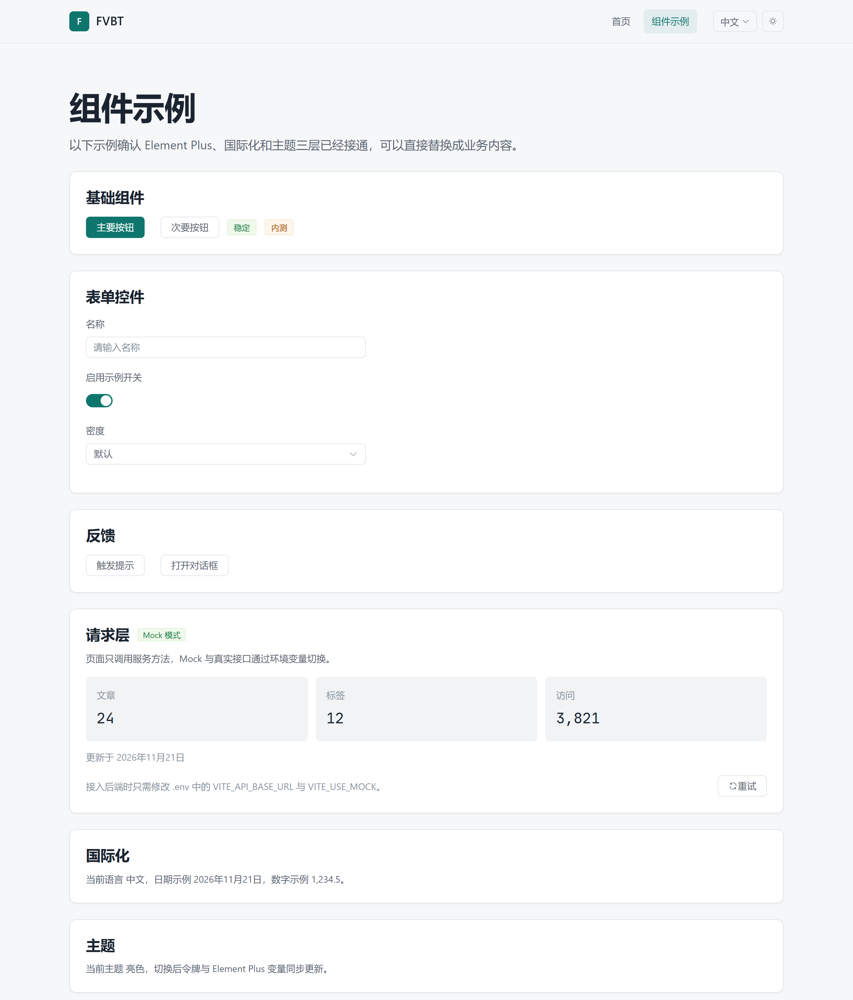
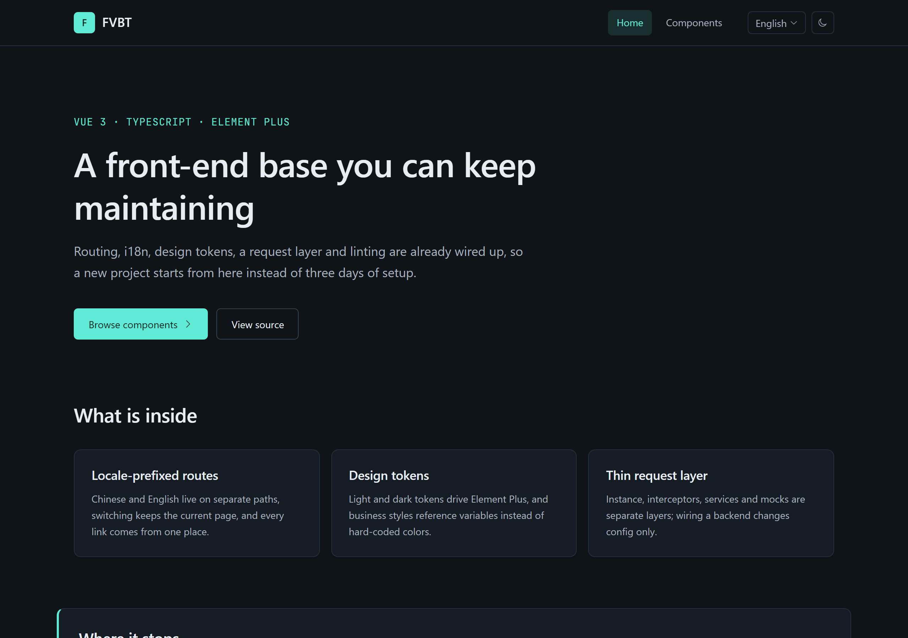

# FVBT

**简体中文** | [English](./README.en.md)

[](https://github.com/GooHvLiu/FVBT/actions/workflows/ci.yml)


一个可以直接开工的前端基座模板：**Vue 3 + TypeScript + Element Plus + Vite**，内置中英双语、亮暗主题令牌、语言前缀路由、极薄请求层与完整的工程规范链。

FVBT 只做「内容型站点」的底座，开箱即用，不塞业务脚手架；需要权限、动态菜单、工作流这类后台能力时，请使用 V3TM，两边不重复建设。

- 版本：**1.0.0**
- 许可证：**MIT**
- 文档语言：中文 / English（`README.en.md`）

## 界面预览

| 中文首页（亮色）                              | 中文首页（暗色）                             |
| --------------------------------------------- | -------------------------------------------- |
|  |  |

| 组件示例页                                | 英文界面 + 暗色主题                     |
| ----------------------------------------- | --------------------------------------- |
|  |  |

截图来自本仓库的预渲染产物，1280 宽桌面端，未做后期处理。

---

## 1. 定位与边界

FVBT 想解决的问题很具体：每开一个新站点，路由前缀、i18n 词条、主题令牌、请求封装、Lint 规则这些东西都要重搭一遍，而且每次细节都不一样。这个模板把它们固化成一套可维护的基线。

**保留的能力**

| 能力         | 说明                                                                       |
| ------------ | -------------------------------------------------------------------------- |
| 语言前缀路由 | 中文走根路径，英文走 `/en`，页面路径与语言无关地由 `routeKey` 生成         |
| 国际化       | `vue-i18n` Composition API 模式，中英词条按类型强制结构一致                |
| 主题令牌     | 一套 `--fvbt-*` 变量驱动自身样式，并映射到 Element Plus 变量               |
| 请求层       | axios 实例 + 拦截器 + 服务层 + Mock 适配器，切后端只改环境变量             |
| SEO          | `@unhead/vue` 统一注入 title / description / canonical / hreflang          |
| 预渲染       | `vite-ssg` 输出静态 HTML，适配 Netlify 这类纯静态托管                      |
| 质量门       | ESLint + Stylelint + Prettier + vue-tsc + commitlint + husky + lint-staged |

**明确不做**

RBAC、动态菜单、微前端、表单引擎、多皮肤系统、GraphQL、状态库、单元测试脚手架、组件二次封装层。这些属于更高一层的业务框架（V3TM）或具体项目，模板里预装只会变成死代码。

---

## 2. 特性一览

- **零配置起步**：`npm install` 之后 `npm run dev` 就能跑，不需要再改别名、tsconfig 或构建脚本。
- **路由即语言**：`/` ↔ `/en`，切换语言保留当前页面语义，链接不手写前缀。
- **主题可扩展**：所有颜色、间距、圆角、字号都收敛在 `tokens.scss`，改一处全站生效。
- **暗色模式**：首帧前内联脚本判定主题，避免白屏闪烁；局部样式不需要写两套。
- **按需引入**：Element Plus 组件与样式按需加载，全站基础包约 190 kB（gzip 70 kB）。
- **Mock 先行**：没有后端也能演示请求流程，接入后端时页面代码一行不改。
- **静态托管友好**：目录式预渲染（`/demo/`、`/en/`、`/404/`），GitHub Pages、Netlify 都按真实路径访问，不需要服务端重写。
- **工程规范**：保存即格式化，提交即校验，提交信息遵循 Conventional Commits。

---

## 3. 技术栈

| 类别      | 选型                                  | 版本    |
| --------- | ------------------------------------- | ------- |
| 框架      | Vue                                   | 3.5.46  |
| 语言      | TypeScript                            | 6.0.3   |
| 构建      | Vite                                  | 8.3.8   |
| 预渲染    | vite-ssg                              | 28.3.0  |
| UI        | Element Plus                          | 2.14.8  |
| 图标      | @element-plus/icons-vue               | 2.3.2   |
| 路由      | vue-router                            | 5.5.1   |
| 国际化    | vue-i18n                              | 11.4.23 |
| 请求      | axios                                 | 1.21.1  |
| Head 管理 | @unhead/vue                           | 2.1.18  |
| 样式      | Sass（`@use` 语法）                   | 1.108.2 |
| 规范      | ESLint 10 / Stylelint 18 / Prettier 3 | —       |

依赖全部使用精确版本（`.npmrc` 中 `save-exact=true`），避免不同机器装出不同的小版本。

> TypeScript 固定在 6.0.3，因为 `typescript-eslint@8` 的 peer 范围是 `<6.1.0`；`@unhead/vue` 固定在 2.1.18，因为 `vite-ssg@28` 依赖 2.x。升级这两个之前请先核对 peer 约束。

---

## 4. 环境要求

- Node.js **>= 20.19.0**（推荐 22，仓库内有 `.nvmrc`）
- npm **>= 10**
- 不需要全局安装任何 CLI

```bash
node -v   # v22.x
npm -v    # 10.x
```

---

## 5. 快速开始

```bash
# 1. 安装依赖
npm install

# 2. 本地开发，默认 http://localhost:5173
npm run dev

# 3. 类型检查 + 预渲染构建
npm run build

# 4. 预览构建产物，默认 http://localhost:4173
npm run preview
```

`npm install` 时会执行 `husky` 安装 Git 钩子；如果当前目录还不是 Git 仓库会提示 `.git can't be found`，初始化仓库后重新执行 `npm run prepare` 即可。

---

## 6. 目录结构

```
FVBT
├─ docs/images/                 # README 截图
├─ public/
│  ├─ favicon.svg               # 站点图标
│  └─ .nojekyll                 # GitHub Pages 不走 Jekyll 处理
├─ scripts/copy-404.mjs         # 目录式输出后补一份根级 404.html
├─ src/
│  ├─ api/
│  │  ├─ client.ts              # axios 实例、拦截器、统一错误
│  │  ├─ mock.ts                # 开发用 Mock 适配器
│  │  ├─ types.ts               # 接口信封与数据结构
│  │  └─ services/demo.ts       # 按领域拆分的服务方法
│  ├─ assets/styles/
│  │  ├─ tokens.scss            # 亮暗两套设计令牌
│  │  ├─ mixins.scss            # 断点、卡片、焦点环等复用片段
│  │  ├─ element.scss           # Element Plus 变量映射
│  │  └─ global.scss            # 重置、排版、布局基础
│  ├─ components/
│  │  ├─ AppHeader.vue          # 顶栏：导航 + 语言 + 主题 + 移动端抽屉
│  │  ├─ AppFooter.vue          # 页脚：版权、仓库、版本
│  │  ├─ LangSwitcher.vue       # 语言切换
│  │  ├─ ThemeToggle.vue        # 亮暗切换
│  │  └─ icons/index.ts         # 图标统一出口
│  ├─ composables/
│  │  ├─ useAppLocale.ts        # 语言状态、路径生成、语言切换
│  │  ├─ useAppTheme.ts         # 主题状态与持久化
│  │  └─ useAppSeo.ts           # 页面级 head 注入
│  ├─ config/
│  │  ├─ site.ts                # 站点名称、域名、仓库、导航
│  │  ├─ locale.ts              # 语言清单、前缀、html lang
│  │  └─ i18n.ts                # i18n 实例
│  ├─ layouts/AppLayout.vue     # 跳过链接 + 顶栏 + 内容 + 页脚
│  ├─ locales/
│  │  ├─ zh-CN.ts               # 中文词条（结构基准）
│  │  └─ en-US.ts               # 英文词条（受中文结构约束）
│  ├─ pages/
│  │  ├─ HomeView.vue           # 首页
│  │  ├─ DemoView.vue           # 组件与请求层示例
│  │  └─ NotFoundView.vue       # 404
│  ├─ router/
│  │  ├─ routes.ts              # 路由定义与按语言展开
│  │  └─ scroll.ts              # 滚动行为
│  ├─ types/
│  │  ├─ components.d.ts        # 自动生成的组件类型（随仓库提交）
│  │  └─ router.d.ts            # 路由 meta 类型增强
│  ├─ utils/
│  │  ├─ path.ts                # 路径拼接与绝对地址
│  │  ├─ storage.ts             # 带前缀的本地存储封装
│  │  ├─ format.ts              # 日期、数字、相对时间
│  │  └─ feedback.ts            # ElMessage 单点封装
│  ├─ App.vue                   # 根组件，只挂布局
│  └─ main.ts                   # 应用入口：路由、i18n、主题、样式顺序
├─ .env / .env.development / .env.staging / .env.pages / .env.production
├─ .github/workflows/           # ci.yml（质量门）与 pages.yml（Pages 发布）
├─ netlify.toml                 # Netlify 构建、重定向与缓存头
├─ index.html                   # 首帧主题脚本
├─ vite.config.ts               # 插件、别名、base 路径、SSG 选项
└─ tsconfig.json / tsconfig.app.json / tsconfig.node.json
```

---

## 7. 命令脚本

| 命令                    | 作用                                                         |
| ----------------------- | ------------------------------------------------------------ |
| `npm run dev`           | 启动开发服务器                                               |
| `npm run build`         | 类型检查 + 预渲染 + 生成根级 `404.html`（根域名部署用）      |
| `npm run build:pages`   | 同上，但加载 `.env.pages`，带 `/FVBT/` 前缀，供 GitHub Pages |
| `npm run preview`       | 预览 `dist` 产物                                             |
| `npm run typecheck`     | 仅做类型检查（`--force` 忽略增量缓存）                       |
| `npm run lint`          | ESLint 检查，警告也算失败                                    |
| `npm run lint:fix`      | ESLint 自动修复                                              |
| `npm run stylelint`     | 检查 `.vue` / `.scss` / `.css` 样式                          |
| `npm run stylelint:fix` | 样式自动修复                                                 |
| `npm run format`        | Prettier 全量格式化                                          |
| `npm run format:check`  | 只检查格式，用于 CI                                          |
| `npm run check`         | lint + stylelint + typecheck，提交前自查                     |
| `npm run prepare`       | 安装 husky 钩子                                              |

---

## 8. 配置说明

### 8.1 环境变量

| 变量                   | 说明                                                     | 默认                       |
| ---------------------- | -------------------------------------------------------- | -------------------------- |
| `VITE_APP_TITLE`       | 站点名称，用于页脚与标题后缀                             | `FVBT`                     |
| `VITE_APP_DESCRIPTION` | 默认描述，页面未指定时回落到这里                         | 见 `.env`                  |
| `VITE_SITE_URL`        | 部署域名，用于 canonical 与 hreflang，末尾不带斜杠       | `https://fvbt.example.com` |
| `VITE_BASE_PATH`       | 部署子路径，根域名用 `/`，GitHub Pages 项目页用 `/FVBT/` | 见 `.env.*`                |
| `VITE_API_BASE_URL`    | 接口前缀                                                 | `/api`                     |
| `VITE_USE_MOCK`        | `true` 走 Mock 适配器，`false` 走真实接口                | 见 `.env.*`                |

环境文件分工：`.env` 放公共默认值，`.env.development` 打开 Mock，`.env.staging` 指向预发布域名，`.env.pages` 供 GitHub Pages 使用（`/FVBT/` 前缀 + 站点地址），`.env.production` 为静态演示保留 Mock——接真实后端的项目请把 `VITE_USE_MOCK` 改成 `false` 并替换 `VITE_API_BASE_URL`。

### 8.2 站点信息

`src/config/site.ts` 里改这几处就能上线：

```ts
export const siteConfig = {
  name: import.meta.env.VITE_APP_TITLE || 'FVBT',
  url: (import.meta.env.VITE_SITE_URL || 'https://fvbt.example.com').replace(/\/+$/, ''),
  repository: 'https://github.com/GooHvLiu/FVBT', // 换成自己的仓库
  license: 'MIT',
  // ...
}
```

`navItems` 控制顶栏导航，`routeKey` 必须与 `router/routes.ts` 中的定义一致，`labelKey` 指向 `locales` 词条。

### 8.3 设计令牌

`src/assets/styles/tokens.scss` 定义了亮暗两套变量，命名统一带 `--fvbt-` 前缀：颜色、背景、边框、圆角、阴影、字体栈、字号、行高、过渡时长。业务样式只引用变量，不写死色值，切换主题时自动跟随。

Element Plus 的变量在 `element.scss` 里被映射到这套令牌，因此 `el-button`、`el-tag` 等组件的主题色与站点保持一致。

---

## 9. 开发约定

### 9.1 路由

页面在 `src/router/routes.ts` 的 `appRouteDefinitions` 中登记一次即可，`createLocaleRoutes()` 会按语言展开成 `/`、`/en`、`/demo`、`/en/demo`，并追加兜底路由。

```ts
{
  key: 'demo',                       // 跨语言稳定的页面标识
  path: '/demo',                     // 不带语言前缀
  component: () => import('@/pages/DemoView.vue'),
}
```

链接一律用 `pathFor('demo')` 生成，不要手写 `/en/demo`：

```vue
<RouterLink :to="pathFor('demo')">{{ t('nav.demo') }}</RouterLink>
```

### 9.2 国际化

- 词条按命名空间组织：`common`、`nav`、`home`、`demo`、`notFound`、`seo`。
- `zh-CN.ts` 是结构基准，`en-US.ts` 通过 `MessageSchema` 类型约束，缺词条会直接编译失败。
- 组件里用 `const { t, locale } = useI18n()`，日期与数字统一走 `utils/format.ts` 的 `formatDate` / `formatNumber`，不要手工拼字符串。

### 9.3 主题

```ts
const { theme, isDark, setTheme, toggleTheme } = useAppTheme()
```

主题写在 `html[data-theme]` 与 `.dark` 两处，持久化 key 为 `fvbt:theme`，首帧由 `index.html` 内联脚本决定。

### 9.4 请求层

调用链固定为「页面 → 服务 → client → axios / mock」：

```ts
// src/api/services/demo.ts
export const demoService = {
  getOverview: () => request<OverviewData>('/demo/overview'),
}
```

`client.ts` 会把响应拆成统一信封 `{ code, data, message }`，`code !== 0` 抛出 `ApiError`。Mock 适配器只拦截 `VITE_USE_MOCK === 'true'` 时的请求，页面代码不区分环境。

### 9.5 反馈与图标

- 提示统一走 `utils/feedback.ts` 的 `showMessage`，Element Plus 的样式只在这里显式引入，避免散落。
- 图标从 `@/components/icons` 引入，新增图标在 `icons/index.ts` 登记后即可使用。
- Element Plus 组件由 `unplugin-vue-components` 按需解析，模板里直接写 `<el-button>`，不需要手动 import。

---

## 10. 常见改动recipe

### 新增一个页面

1. 在 `src/pages/` 新建 `AboutView.vue`，用 `useAppSeo` 声明标题。
2. 在 `appRouteDefinitions` 增加 `{ key: 'about', path: '/about', component: () => import('@/pages/AboutView.vue') }`。
3. 把导航项加进 `site.ts` 的 `navItems`，并在中英词条里补 `nav.about`。
4. 需要描述时在 `seo` 命名空间补 `aboutTitle` 之类的 key。

### 新增一门语言

1. 在 `src/config/locale.ts` 的 `APP_LOCALES` 增加语言码，并补 `localeMeta`（前缀、html lang、展示名）。
2. 在 `src/locales/` 新建对应词条文件，按 `MessageSchema` 补齐结构。
3. 在 `src/config/i18n.ts` 的 `messages` 中注册。

路由、语言切换、hreflang 会自动跟着扩展，不需要改 `routes.ts`。

### 新增一个接口

1. 在 `src/api/types.ts` 补数据结构。
2. 在 `src/api/services/` 按领域新增服务文件。
3. Mock 阶段在 `src/api/mock.ts` 里补一条响应，切真实接口时改 `.env` 即可。

---

## 11. 构建与部署

`npm run build` 会先做类型检查，再用 `vite-ssg` 预渲染，输出目录式结构——每个页面是独立目录下的 `index.html`，静态托管按真实路径直接命中，不依赖扩展名重写：

```
dist/
├─ index.html          # 中文首页
├─ demo/index.html     # 中文示例页
├─ en/index.html       # 英文首页
├─ en/demo/index.html  # 英文示例页
├─ 404/index.html      # 未命中地址
├─ 404.html            # 根级兜底，供静态托管回退
├─ .nojekyll
└─ assets/             # 带 hash 的 js / css
```

`404.html` 由 `scripts/copy-404.mjs` 在构建末尾从 `404/index.html` 复制而来，Netlify、GitHub Pages 的兜底规则都指向它。

### GitHub Pages

仓库自带 `.github/workflows/pages.yml`，push 到 `main` 后自动构建并发布到 `https://goohvliu.github.io/FVBT/`。

Pages 的项目页挂在子路径 `/FVBT/` 下，所以构建要带前缀，由 `.env.pages` 提供：

```
VITE_SITE_URL=https://goohvliu.github.io/FVBT
VITE_BASE_PATH=/FVBT/
```

`vite.config.ts` 读取 `VITE_BASE_PATH` 作为 `base`，`main.ts` 把 `import.meta.env.BASE_URL` 交给 `ViteSSG`，路由前缀、静态资源地址、canonical 与 hreflang 会一起跟着变；本地验证用：

```bash
npm run build:pages
npx vite preview --mode pages   # 访问 http://localhost:4173/FVBT/
```

首次发布需要在仓库 **Settings → Pages** 把 Source 选成 **GitHub Actions**，工作流才有发布权限；换成自己的仓库时，把 `.env.pages` 里的 `/FVBT/` 改成仓库名即可。

### Netlify

仓库根目录已带 `netlify.toml`：

```toml
[build]
command = "npm run build"
publish = "dist"
```

在 Netlify 上「Import an existing project」选择仓库后，构建设置会被自动读取；只需在站点设置里补环境变量（`VITE_SITE_URL` 等）。未命中路径由 `/*` → `/404.html` 兜底，静态资源带一年期 immutable 缓存头。

### 其他静态托管

产物是纯静态文件，Nginx、Cloudflare Pages、Vercel 都能托管；挂在子路径（如 `/site/`）时，把 `VITE_BASE_PATH` 设成对应前缀再构建，并把未知路径回落到 `404.html`。

---

## 12. 质量门

| 环节       | 工具                                         | 触发时机                              |
| ---------- | -------------------------------------------- | ------------------------------------- |
| 代码规范   | ESLint（flat config，Vue + TS 推荐规则）     | 保存、`npm run lint`、pre-commit      |
| 样式规范   | Stylelint（standard-scss + recommended-vue） | 保存、`npm run stylelint`、pre-commit |
| 格式       | Prettier（无分号、单引号、100 列、LF）       | 保存、pre-commit、CI                  |
| 类型       | vue-tsc（strict + noUnusedLocals）           | `npm run typecheck`、构建、CI         |
| 提交信息   | commitlint（Conventional Commits）           | commit-msg 钩子                       |
| 暂存区检查 | lint-staged                                  | pre-commit                            |

提交信息格式：

```
feat(router): 支持语言前缀路由
fix(api): 修正错误码透传
docs(readme): 补充部署说明
```

---

## 13. 常见问题

**构建时报 `.css` 扩展名错误？**
预渲染阶段 Node 直接加载了 Element Plus 的样式文件。`vite.config.ts` 已配置 `ssr.noExternal: ['element-plus']`，如果你改过该配置请保留。

**类型检查报找不到 `el-*` 组件？**
`src/types/components.d.ts` 由 `unplugin-vue-components` 生成，仓库里已提交一份。新增 Element Plus 组件后运行一次 `npm run dev` 或 `npm run build` 即可刷新。

**暗色模式有闪烁？**
首帧由 `index.html` 内联脚本读取 `fvbt:theme` 与系统偏好设置，若把这段脚本删掉就会出现白闪。

**`prepare` 报 `.git can't be found`？**
当前目录还不是 Git 仓库。初始化仓库后执行 `npm run prepare`。

**能不用预渲染吗？**
可以。把 `build` 脚本换成 `vue-tsc --build && vite build`，同时删掉 `main.ts` 里的 `ViteSSG` 包装即可退化成普通 SPA，但会失去静态首屏与 SEO 收益。

**部署到子路径后样式和跳转都失效？**
这是 `base` 没跟着变。用 `VITE_BASE_PATH=/你的子路径/` 重新构建，路由与资源地址会一起改写；本地核对用 `npx vite preview --mode pages`，直接开 `/你的子路径/` 而不是根路径。

---

## 14. 参与贡献

欢迎提 Issue 与 PR。提交前请先跑：

```bash
npm run check
npm run build
```

约定：一个 PR 只做一件事；新增能力请同步补中英词条与 README；不要引入与本模板定位冲突的后台能力。

---

## 15. 许可证

[MIT](./LICENSE) © 2026 FVBT
